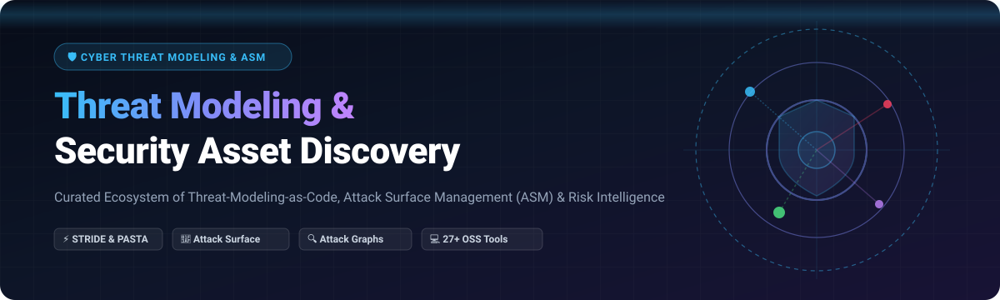
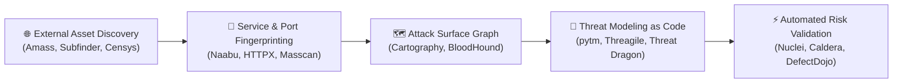

# 🛡️ Awesome Threat Modeling & Security Asset Discovery

      

---

## 📌 Executive Overview & Core Concepts

**Threat Modeling** and **Security Asset Discovery (Attack Surface Management - ASM & Cyber Asset Attack Surface Management - CAASM)** represent fundamental pillars of modern cyber defense, proactive software security design, and continuous exposure reduction.

As cloud-native architectures, microservices, multi-cloud deployments, and distributed remote environments proliferate, modern enterprises face an ever-widening gap between intended security designs and actual deployed infrastructure. Proactive security engineering demands:
- 🧩 **Automated Threat Modeling**: Modeling architecture, identifying architectural design flaws, and applying frameworks like **STRIDE**, **PASTA**, **LINDDUN**, and **MITRE ATT&CK** before code hits production.
- 🌐 **Continuous Security Asset Discovery**: Uncovering internet-exposed subdomains, rogue cloud instances, shadow IT, exposed APIs, and misconfigured buckets in real time.
- ⚡ **Threat-Modeling-as-Code (TMaC)**: Shifting security architecture reviews left by declaring architectural boundaries and data flows directly in CI/CD pipelines via code (YAML, Python, Go).
- 🗺️ **Attack Graph & Path Analysis**: Mapping identity privileges, network perimeters, and reachability paths to pinpoint the exact sequence of vulnerabilities an adversary can exploit to reach critical crown jewels.

This repository (`Awesome-Threat-Modeling-Security-Asset-Discovery`) is a comprehensive, community-curated directory tracking leading **Enterprise SaaS / Commercial Platforms** and **Flagship Open-Source GitHub Projects**.

---

## 📑 Table of Contents

- [📌 Executive Overview & Core Concepts](#-executive-overview--core-concepts)
- [📊 Sector Overview & Market Dynamics](#-sector-overview--market-dynamics)
- [☁️ Enterprise SaaS & Commercial Platforms](#️-enterprise-saas--commercial-platforms)
- [🛠️ Open-Source GitHub Projects](#️-open-source-github-projects)
- [🔄 Threat Modeling & Asset Discovery Workflow](#-threat-modeling--asset-discovery-workflow)
- [🤝 How to Contribute](#-how-to-contribute)
- [💖 Support & Sponsoring](#-support--sponsoring)
- [⚖️ Disclaimer](#️-disclaimer)
- [📈 Star History](#-star-history)

---

## 📊 Sector Overview & Market Dynamics

> 📈 **Sector Analysis**: The combined global market for **Threat Modeling Software**, **Attack Surface Management (ASM)**, and **Cyber Asset Attack Surface Management (CAASM)** is estimated at **$2.5 Billion – $3.2 Billion (2026)**, expanding rapidly at an estimated **CAGR of ~22.8%** through 2030.
> 
> The sector is **moderately fragmented**: while large enterprise cyber conglomerates (such as Microsoft, Cisco, CrowdStrike, and Tenable) continue acquiring point capabilities and bundling exposure management into broad XDR suites, high specialized demand for automated Threat-Modeling-as-Code engines, continuous internet recon graphs, and developer-first threat diagramming prevents a pure "winner-take-all" outcome, leaving substantial runway for category-defining specialist platforms (like IriusRisk, ThreatModeler, Censys, CyCognito, and Balbix).

---

## ☁️ Enterprise SaaS & Commercial Platforms

The following SaaS and hosted enterprise platforms provide automated threat diagramming, continuous perimeter reconnaissance, threat-models-as-code orchestration, and cyber exposure management.

*(Sorted by Company Size / Valuation in descending order)*

| 🏢 Platform / Vendor | 💰 Company Size (Valuation / Revenue) | 🏷️ Starting Tier Price | 🎁 Free Tier / Free Trial Limits | 🔍 Core Threat Modeling & Asset Discovery Capabilities |
| :--- | :--- | :--- | :--- | :--- |
| **[Microsoft Threat Modeling Tool / Defender EASM](https://www.microsoft.com/en-us/security)** | ~$3.1 Trillion Market Cap / ~$245B Revenue | $0.01 / asset / day (~$300/mo per 1,000 external assets for Defender EASM) | 100% Free Desktop Tool (DFD / STRIDE) + 30-day Defender EASM trial (up to 500 assets) | Industry-standard desktop STRIDE threat modeling tool; cloud-scale external discovery engine integrated with Sentinel and Copilot for Security. |
| **[Cisco Vulnerability Management](https://www.cisco.com/site/us/en/products/security/vulnerability-management/index.html)** *(Kenna Security)* | ~$230 Billion Market Cap / ~$54B Revenue | ~$18,000 / year (starts at ~$1,500/mo for base tier up to 1,000 assets) | 30-day full access guided proof-of-concept trial (limited to 500 asset scope) | Risk-based vulnerability management and asset discovery correlating exploit telemetry and CVE weaponization with asset business context. |
| **[CrowdStrike Falcon Surface](https://www.crowdstrike.com/products/exposure-management/falcon-surface/)** *(Reposify)* | ~$85 Billion Market Cap / ~$3.9B Revenue | ~$30,000 / year (starts at ~$2,500/mo bundled with Falcon platform) | 15-day Falcon Surface interactive sandbox trial with guided perimeter discovery | Continuous internet-wide scanning discovering external-facing cloud instances, orphaned subdomains, and exposed remote services. |
| **[Tenable Exposure Management & ASM](https://www.tenable.com/products/tenable-asm)** *(Lumin / BitDiscovery)* | ~$5.0 Billion Market Cap / ~$860M Revenue | ~$3,000 / year ($6 / asset / year for 500 monitored assets) | 30-day Tenable ASM free trial monitoring up to 250 external domain & IP assets | External perimeter asset cartography, attack path analysis, and Cyber Exposure Score (CES) benchmarking across hybrid environments. |
| **[CyCognito](https://www.cycognito.com/)** | ~$800 Million Valuation / ~$60M Revenue | ~$35,000 / year (enterprise tier covering up to 1,500 discovered assets) | 14-day guided proof-of-concept trial with comprehensive external attack surface report | Autonomous external asset reconnaissance and exploitability testing simulating multi-stage adversary reconnaissance against unknown assets. |
| **[Censys ASM](https://censys.com/)** | ~$350 Million Valuation / ~$40M Revenue | $500 / month ($5,000 / year for Censys Pro API / Starter ASM) | Free Forever Community Plan (250 search queries/mo) + 14-day ASM full trial | High-fidelity global internet sensor graph monitoring TLS certificate logs, exposed web endpoints, and dynamic cloud assets daily. |
| **[Balbix](https://www.balbix.com/)** | ~$300 Million Valuation / ~$35M Revenue | ~$25,000 / year (base enterprise license for up to 2,500 physical/cloud assets) | 14-day guided sandbox demo trial evaluating up to 250 test workloads | AI-powered Cyber Risk Quantification (CRQ), automated continuous inventory of hardware/software/cloud assets, and breach likelihood analytics. |
| **[IriusRisk](https://www.iriusrisk.com/)** | ~$250 Million Valuation / ~$25M ARR | €1,200 / user / year (~$100 / user / month billed annually; starter packs from $12,000/yr) | Free Forever Community Edition (up to 5 active threat models, 1 user) + 14-day Enterprise trial | Leading automated architectural threat modeling platform featuring visual DFDs, rules engines, and bi-directional Jira/GitHub issue synchronization. |
| **[Brinqa](https://www.brinqa.com/)** | ~$200 Million Valuation / ~$30M Revenue | ~$20,000 / year (Cyber Risk Graph foundation tier) | 14-day enterprise proof-of-value trial on customer-provided scanner telemetry | Unified Exposure Management aggregating CMDB, cloud platforms, and 150+ security scanners into an interconnected Cyber Risk Knowledge Graph. |
| **[ThreatModeler](https://threatmodeler.com/)** | ~$150 Million Valuation / ~$20M Revenue | ~$15,000 / year (base team tier with cloud drift monitoring) | 14-day guided sandbox trial with sample architecture templates | Patented enterprise threat modeling platform with Threat-Modeling-as-Code (IaC scans for Terraform/CloudFormation) and cloud architectural drift detection. |
| **[SD Elements by Security Compass](https://www.securitycompass.com/sdelements/)** | ~$120 Million Valuation / ~$25M Revenue | ~$18,000 / year (starts for development teams of up to 25 software engineers) | 14-day full feature team trial with 3 active application security profiles | Policy-to-code automation translating regulatory frameworks (NIST, ISO 27001, PCI-DSS) into developer-assigned threat mitigations and tasks. |

---

## 🛠️ Open-Source GitHub Projects

Open-source tools offer complete transparency, self-hosted privacy, extensible APIs, and customizable rulesets for security architects, AppSec teams, and penetration testers.

*(Sorted by GitHub_Stars in descending order)*

1. ⚡ **[Nuclei](https://github.com/projectdiscovery/nuclei)**   
   *Fast, customizable vulnerability scanner based on simple YAML templates for automated exposure and misconfiguration checks across discovered assets.*

2. 🚀 **[Masscan](https://github.com/robertdavidgraham/masscan)**   
   *Ultra-fast asynchronous TCP port scanner capable of scanning entire internet ranges in minutes to discover open ports and live hosts.*

3. 🕷️ **[SpiderFoot](https://github.com/smicallef/spiderfoot)**   
   *Modular OSINT automation and attack surface discovery tool integrating 200+ modules for asset reconnaissance and exposure identification.*

4. 📦 **[NetBox](https://github.com/netbox-community/netbox)**   
   *Premier open-source IP address management (IPAM) and data center infrastructure management (DCIM) tool acting as a foundational source of truth for network assets.*

5. 🌐 **[OWASP Amass](https://github.com/owasp-amass/amass)**   
   *Industry-standard attack surface mapping and external asset discovery engine performing in-depth DNS enumeration, scraping, and graph-based asset intelligence.*

6. 🔍 **[Subfinder](https://github.com/projectdiscovery/subfinder)**   
   *Fast passive subdomain discovery tool querying dozens of passive DNS, certificate transparency, and threat intelligence sources.*

7. 🌐 **[HTTPX](https://github.com/projectdiscovery/httpx)**   
   *Multi-purpose HTTP toolkit probing discovered hosts for live web servers, technology stacks, TLS certificates, status codes, and response fingerprints.*

8. 🛡️ **[OpenCTI](https://github.com/OpenCTI-Platform/opencti)**   
   *Cyber Threat Intelligence (CTI) platform structuring threat actors, attack vectors, vulnerabilities, and enterprise assets into a unified STIX2 knowledge graph.*

9. 🎯 **[rEngine](https://github.com/yogeshojha/rengine)**   
   *Automated reconnaissance and external attack surface management suite combining configurable YAML workflows, subdomain/port discovery, and vuln tracking.*

10. 🗄️ **[Steampipe](https://github.com/turbot/steampipe)**   
    *Zero-ETL cloud asset query engine allowing security teams to query live APIs of AWS, Azure, GCP, Kubernetes, and GitHub using standard SQL.*

11. ⚔️ **[MITRE Caldera](https://github.com/mitre/caldera)**   
    *Automated adversary emulation and threat modeling validation platform built on MITRE ATT&CK to systematically test defensive controls against attack chains.*

12. ☁️ **[CloudQuery](https://github.com/cloudquery/cloudquery)**   
    *High-performance open-source ELT framework extracting multi-cloud infrastructure and SaaS configurations into SQL databases for asset inventory.*

13. 🔌 **[Naabu](https://github.com/projectdiscovery/naabu)**   
    *Fast, reliable port scanner written in Go engineered for rapid SYN/CONNECT discovery sweeps across enterprise perimeter ranges.*

14. 🕵️ **[Recon-ng](https://github.com/lanmaster53/recon-ng)**   
    *Full-featured web reconnaissance framework providing independent modules, database persistence, and interactive discovery workflows.*

15. 📸 **[Aquatone](https://github.com/michenriksen/aquatone)**   
    *Visual attack surface inspection and web screenshotting tool for reconnaissance and validating exposed web interfaces on discovered assets.*

16. 🥋 **[DefectDojo](https://github.com/DefectDojo/django-DefectDojo)**   
    *Leading open-source DevSecOps vulnerability management and risk prioritization hub aggregating assets and findings from 150+ security scanners.*

17. 📷 **[gowitness](https://github.com/sensepost/gowitness)**   
    *Golang-based web screenshot utility utilizing Chrome Headless to visually triage external assets and exposed web interfaces.*

18. 🗺️ **[Cartography](https://github.com/cartography-cncf/cartography)**   
    *CNCF infrastructure asset consolidation tool built by Lyft ingesting AWS, GCP, Azure, Kubernetes, and Okta assets into Neo4j attack graphs.*

19. 🩸 **[BloodHound](https://github.com/SpecterOps/BloodHound)**   
    *Premier open-source graph-based attack path analysis platform mapping identity and privilege escalation paths across Active Directory and Azure/Entra ID.*

20. 🦗 **[Mantis](https://github.com/google/mantis)**   
    *Google-developed attack surface management and security asset discovery framework automating subdomain discovery, port scanning, and exposure detection.*

21. 🧭 **[MITRE ATT&CK Navigator](https://github.com/mitre-attack/attack-navigator)**   
    *Official MITRE web application for visualizing, annotating, and mapping adversary tactics and techniques onto organizational threat models.*

22. 🐉 **[OWASP Threat Dragon](https://github.com/OWASP/threat-dragon)**   
    *Flagship OWASP open-source threat modeling studio supporting STRIDE, LINDDUN, CIA, and DIE methodologies with DFD diagramming.*

23. 🤖 **[AttackGen](https://github.com/mrwadams/attackgen)**   
    *Cybersecurity incident response and adversary simulation testing tool leveraging LLMs and the MITRE ATT&CK framework to generate tailored threat scenarios.*

24. 🔎 **[OWASP Maryam](https://github.com/saeeddhqan/Maryam)**   
    *Modular open-source OSINT and web-based asset reconnaissance framework written in Python for external footprinting and intelligence gathering.*

25. 🐍 **[pytm](https://github.com/OWASP/pytm)**   
    *Pythonic Threat-Modeling-as-Code framework by OWASP enabling security architects to define systems in Python and auto-generate DFDs and reports.*

26. 📝 **[Threat Composer](https://github.com/awslabs/threat-composer)**   
    *AWS-developed interactive threat modeling tool designed to help developers and architects compose, organize, and export threat models directly in browsers or CI.*

27. 📐 **[Threagile](https://github.com/Threagile/threagile)**   
    *Agile Threat-Modeling-as-Code toolkit in Go modeling architectures in YAML, running automated risk evaluation rules and generating DFDs and reports.*

---

## 🔄 Threat Modeling & Asset Discovery Workflow

---

## 🤝 How to Contribute

Contributions are welcome! Please follow these contribution standards:
1. Ensure open-source projects have an active GitHub repository with clear documentation and a permissive open-source license.
2. For SaaS tools, provide verifiable starting pricing details, trial limits, and official vendor documentation links.
3. Keep descriptions objective, concise, and focused on threat modeling, asset discovery, and exposure management capabilities.
4. Submit your pull request with a brief summary explaining why the tool is a valuable addition to the ecosystem.

---

## 💖 Support & Sponsoring

Thank you for exploring and utilizing **Awesome Threat Modeling & Security Asset Discovery**! If this curated ecosystem guide assists your security architecture reviews, threat modeling initiatives, or perimeter asset reconnaissance workflows, please consider supporting the project:

- ⭐ **Star** this repository to help other security architects and DevSecOps teams discover it.
- 🔄 **Fork** and contribute newly launched threat-modeling frameworks or discovery tools.
- 📢 **Share** this list across your engineering teams, infosec networks, and community channels.
- ☕ **Sponsor / Buy Me a Coffee**: Help sustain ongoing research and curation across open-source security intelligence directories via the [GitHub Sponsor Dashboard](https://github.com/sponsors/ishandutta2007).

---

##  Star History

---

## ⚖️ Disclaimer

*This curated directory is provided for educational, research, and defensive security engineering purposes. Trademarks and product names belong to their respective owners. Mention of commercial products or open-source software does not constitute formal endorsement.*
